# UI/UX Critique & Change Proposal

_Written 2026-11-02. Scope: the whole PWA as it stands on `main` (`1abe8ce`),
after the seven-phase redesign, follow-up Phases A–D1 and the v6 plan. Plan
only, no product code changed. Owner decisions recorded in §8: the Nothing OS
skin is discarded, the design direction in §5 is approved, the effort rating is
asked on Today, and HRV uses Garmin's own baseline._

**Mockups:** [`docs/mockups/ui-ux-critique-mockup.html`](mockups/ui-ux-critique-mockup.html).
Open it in a browser to see each current screen beside the proposal, in light or
dark, with the change IDs from this document shown as pink tags. The rendered
images in this document live in [`docs/mockups/ui-ux-critique/`](mockups/ui-ux-critique/).

---

## Contents

1. [How this was reviewed](#1-how-this-was-reviewed)
2. [Verdict](#2-verdict)
3. [What to keep](#3-what-to-keep)
4. [Critique](#4-critique)
   - [4.1 Cross-cutting: chrome, IA, identity](#41-cross-cutting-chrome-ia-identity)
   - [4.2 Today](#42-today)
   - [4.3 Plan](#43-plan)
   - [4.4 Activities](#44-activities)
   - [4.5 Run analysis (activity detail)](#45-run-analysis-activity-detail)
   - [4.6 Progress](#46-progress)
   - [4.7 Coach](#47-coach)
   - [4.8 Settings](#48-settings)
   - [4.9 Accessibility](#49-accessibility)
5. [Design direction](#5-design-direction)
6. [Proposed screens](#6-proposed-screens)
7. [Implementation plan](#7-implementation-plan)
8. [Owner decisions](#8-owner-decisions)
9. [Risks and non-goals](#9-risks-and-non-goals)
10. [Appendix: finding index](#10-appendix-finding-index)

---

## 1. How this was reviewed

- **Real app, real data.** The backend from this repo ran on a copy of the
  seeded `perf/perf.db` (three years of a sub-3:30 marathoner's training,
  migrated to head), with the Vite dev server proxied to it. No fixtures.
- **Consistent "today".** The seed ends on 2026-06-23. The browser clock
  (Playwright `clock.install`) and the server clock (`time-machine`) were both
  pinned to 23 June 2026 18:30 Europe/Belgrade, so Today, Plan and training load
  all agree on the same day.
- **Viewports.** 390 × 844 (primary), 1280 × 800 (desktop rail), dark and light.
- **Code read** for every finding that claims a cause; each one cites `file:line`.
- **Seed artifacts excluded.** Some content is synthetic and was **not** counted
  as a UI defect: repeated insight titles, identical 73 km weeks, 100% adherence
  with 0 s deviations, decimal pace ("4.80 min/km") in seeded insight text (the
  real coach context formats `m:ss`, `app/coach/context.py:114-116`), and JSON in
  the seeded `training_preferences`. Where the UI amplifies a seed quirk (for
  example, insights with no date to tell repeats apart), the UI part still
  counts.

### Relationship to earlier documents

| Document | Status | How this one relates |
|---|---|---|
| `UI_UX_REDESIGN_PLAN.md` + review | Delivered (Phases 0–6, A–D1) | This builds on it. The 5-tab IA, hero concept, day-state machine and tokens all stay. |
| `NOTHING_OS_SKIN_PLAN.md` | **Abandoned 2026-11-02** (owner: "unreadable") | The implementation on `origin/claude/activity-nothing-theme-ui-4qgdfo` stays unmerged. This document's §5 is the visual direction instead. |
| `IMPLEMENTATION_PLAN.MD` (v6) | Planned | B-3 (structured steps on AI plan days) is a data dependency for the session hero and plan rows. |

---

## 2. Verdict

The redesign fixed the structural problems it set out to fix. The app now has a
clear 5-tab IA, a hero, real loading/empty/error states, and desktop layouts.
What remains is a **second-order problem: the app shows a lot of data but rarely
says what it means**, and it spends its best screen space on chrome that does
nothing.

The five changes that matter most:

1. **Recognise the run the athlete just did (T1, P6).** Today's interval run at
   10:20 lands at the very bottom under "Also today", while the hero still offers
   to send the same workout to the watch and Plan still shows 0.0 of 73 km. The
   app's core loop is plan, then run, then feedback, and it breaks on the day
   itself.
2. **Make the workout the hero (T2, T3).** The hero says "INTERVALS · 9.00 km ·
   4:54/km". It never says *6 × 800 m at 4:00 with 400 m jogs*, the only thing a
   runner needs to know before lacing up.
3. **Remove inert chrome (X1–X4).** A 72px week strip sits on all five tabs but
   only Today reads it. The top bar spends its space on an ISO week number, a
   theme toggle and an empty "✓" pill.
4. **Give every number a reference (T6, T7, G2).** Resting HR 49, HRV 42 and
   sleep 56 come with no "compared to what". Five wellness charts in five colours
   never say whether today is normal for *you*.
5. **Give colour one meaning (X5).** Purple currently means brand, fitness,
   B-race, default sport and selected chip. Yellow means both "good" readiness
   and a detraining warning. Proposal: colour means effort, in Garmin's zone
   order, and nothing else.

Fix the correctness items first (§7 Phase 1). They are small, and they decide
whether the athlete trusts the screen.

---

## 3. What to keep

- **5-tab IA** with Coach in the centre, and Settings behind the avatar.
- **The plan day-state machine** (done/missed/today/upcoming) and adherence
  scoring. It is the right model; it just needs to include today (T1).
- **WorkoutStructureBar** as a concept. It should be the hero's main visual, not
  something hidden under a "Description" heading.
- **Activity rows grouped by week with week totals**, PB badges, filter chips.
- **Error boundary, skeletons, reduced-motion handling, focus ring.**
- **Detail page's sticky condensed header** and the verdict-first ordering.
- **Light theme exists**, so the proposal only has to fix it, not add it.

---

## 4. Critique

Severity: **S1** shows wrong or contradictory information · **S2** costs real time
or attention every day · **S3** polish.

### 4.1 Cross-cutting: chrome, IA, identity

| ID | Sev | Finding | Evidence |
|---|---|---|---|
| **X1** | S2 | **The week strip is global but only Today uses it.** It renders on every `chrome: 'main'` route, costing about 72px plus a drag handle on Plan, Coach, Activities and Progress. `DateContext` is read only by `TodayView` and the layout itself (grep `useDateContext`). Tapping a day on Activities or Progress changes nothing visible. On Plan it competes with the week tabs and the day list, so there are three week navigators on one screen. | `App.tsx:115-130`, `WeekStrip.tsx:12-63` |
| **X2** | S2 | **"Week 26/53" is the ISO week of the year**, which no runner tracks. The useful context is the training block: "Build, week 1 of 4" and "Berlin in 90 days". The data exists (`TrainingPlan.phase`, season plan, races). | `TopBar.tsx:26-36` |
| **X3** | S3 | **The theme toggle takes top-bar space for a set-once preference**, and the app ignores `prefers-color-scheme` (defaults to dark, `App.tsx:92-94`, `index.html:15-20`). Runners check the app outdoors in daylight; following the OS fixes that for free. | `TopBar.tsx:38-45` |
| **X4** | S3 | **The sync pill is an empty capsule with a ✓.** `syncing` can never fire (comment at `SyncStatusPill.tsx:26-27`) and the time is hidden until tapped. It costs about 70px of top bar to say "nothing is wrong". Show sync state only when it *is* wrong (needs re-auth, last sync over 6 h ago) and keep a Garmin row in Settings. | `SyncStatusPill.tsx` |
| **X5** | S2 | **Colour carries no single meaning.** Purple `#6c5ce7` is the brand accent, Fitness (CTL), the B-race flag, `--color-default`, selected chips, nav and buttons. Yellow is readiness "Good" (`#fdcb6e`) and ACWR "Detraining". Red is intervals, danger and Zone 5. Workout type is encoded three times per plan row (border, badge, glyph). The palette itself (`#6c5ce7 #a29bfe #00cec9 #e84393 #0984e3 #fdcb6e #e17055`) is the stock "Flat UI" set; with navy `#0f0f1a` it reads as a template, not as this product. | `globals.css:2-31`, `ReadinessCard.tsx:10-15`, `TodayView.tsx:40-45` |
| **X6** | S3 | **Typography has no voice.** The system font stack is fine for prose, but this is an app of numbers (pace, distance, time, HR) and they are set like body text. Every section title, badge and stat label is uppercase with wide letter-spacing (`.section-title`, `globals.css:172-179`): 8–12 shouting labels per screen, which flattens hierarchy instead of creating it. | `globals.css:140-230` |
| **X7** | S3 | **Middle-dot meta strings truncate.** Activity rows pack six values into one ellipsised line ("Tue · 10:20 · 9.22 km · 44:17 · 4:48 /km · ♥ 1…"); at 390px the HR is cut off on most rows. The same pattern appears in the hero ("9.00 km · 4:54/km") and race strips. | Activities screenshot, `ActivityListItem.tsx` |
| **X8** | S3 | **Copy chrome**: "→" appended to links ("View in plan →", "Daily history →", "Set up a plan →"), Title Case headings ("At a Glance", "My Insights"), and "My" in "My Insights" when nobody else's insights exist. | `TodayHero.tsx:125,148,156`, `TodayView.tsx:172,201` |

### 4.2 Today

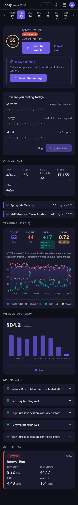

_Current Today at 18:30 on a day with a completed interval run. Bottom nav hidden
for the full-page capture._

| ID | Sev | Finding | Evidence |
|---|---|---|---|
| **T1** | **S1** | **A completed run on an AI-plan day is not recognised until tomorrow.** `/today` tags an activity only when it matches a *Garmin calendar event* (`app/routers/daily.py:186-205`). AI plan days aren't calendar events unless the workout was pushed and re-synced. Plan-day matching (`app/routers/plan.py:81`) is skipped for `day_date >= today`. Result on 23 June: the hero still says **"Send to watch"** for intervals already run at 10:20, the run appears last under "Also today", the Plan row shows ▶ today, and "Aerobic Build 0.0 / 73.0 km". The athlete does the session and the app contradicts them. | Screenshots `before-today-done`, `before-plan` |
| **T2** | S2 | **The hero doesn't say what the workout is.** It shows a red "INTERVALS" pill and "9.00 km · 4:54/km". 4:54 is the *average* including warm-up and jogs, a pace the athlete never actually runs. The structure (6 × 800 m at 4:00, 400 m jog) only appears later, on the activity's adherence card. Partly a data gap (v6 B-3: `TrainingPlanDay` has no `workout_steps`), but the plan day's `description`/`notes` already hold the text. | `TodayHero.tsx:92-106` |
| **T3** | S2 | **Two primary buttons and a card inside a card.** "Send to watch" (wrapping onto two lines at 390px) and "Generate briefing" are both filled purple; the briefing is a bordered card nested inside the hero card. The eye has nowhere to land first. | `TodayHero.tsx:107-127,224-232` |
| **T4** | S2 | **The check-in takes a whole fold.** 15 circles in three rows plus scale legends plus Skip/Log is about 330px. With the hero, that's the entire first screen, so Body, Form and races are below the fold every morning. "Log check-in" is a second step after picking three values. | `DailyCheckinCard.tsx`, viewport screenshot |
| **T5** | **S1** | **"Week 26 Overview" shows 504.2 km**, which is the sum of eight weekly bars (`WeekOverview.tsx:38,78-80`) under a title that names one week. Read literally, it says the athlete ran 504 km this week. | `TodayView.tsx:190-194` |
| **T6** | S2 | **Training load is four coloured numbers, a chip, a paragraph and a four-series chart.** CTL purple, ATL orange, TSB green, ACWR yellow, plus a "Very fresh — detraining risk" chip wrapping over three lines; TSB and ACWR share one axis with CTL/ATL and the result is noise. The useful message fits in one sentence: "Fresh (+17). Fitness steady at 62; fatigue down to 44." | `TrainingLoadChart.tsx` |
| **T7** | S2 | **Numbers without a reference.** At a glance shows RHR 49, Sleep 56, Body battery 74, Steps 17,155, HRV 42, with nothing to say whether those are good *for this athlete*; the 5th tile wraps alone onto a second row. The readiness ring shows 55 and "Good" but not *why* without a tap. | `TodayView.tsx:72-81,170-178` |
| **T8** | S3 | **Insights are a stack of identical collapsed rows**: same bulb icon in random-looking colours, no date, no linked activity. Repeated titles (a seed quirk) can't be told apart because the UI gives no context. | `InsightsList.tsx` |
| **T9** | S3 | **Race strips** are good and compact. The season's A-race (Berlin, 90 days) is absent from Today even though the Plan screen leads with it. | `TodayView.tsx:151-167` |

### 4.3 Plan

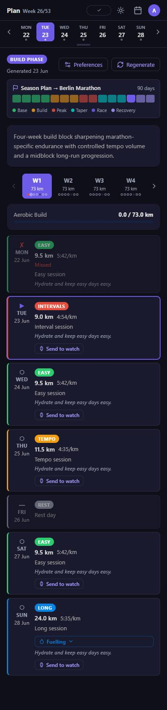

| ID | Sev | Finding | Evidence |
|---|---|---|---|
| **P1** | S2 | **Three week navigators**: the global week strip (X1), the W1–W4 tab carousel with its own arrows, and the seven day cards. The global strip's selected day has no effect on Plan. | `PlanView.tsx`, `App.tsx:121` |
| **P2** | S3 | **Occasional admin actions lead the page.** "BUILD PHASE" pill, "Generated 23 Jun", Preferences and Regenerate all sit above the content. Regenerate shouldn't be one tap from the top of the screen. | `PlanView.tsx` |
| **P3** | S3 | **Repetition**: "Send to watch" on every upcoming day; the same italic note on every row (seeded text, but the UI shows notes unconditionally). | `PlanView.tsx` |
| **P4** | S3 | **Workout type encoded three times**: coloured left border, filled colour badge, state glyph, plus a full purple outline for today. Every row reads loud. | `PlanView.css` |
| **P5** | S3 | **Week tabs say only "73 km"**; the dot rows under them are 4px. The tile has room to show the week's shape (seven mini bars), which is what tells a recovery week from a peak week. | `PlanView.tsx` |
| **P6** | **S1** | **Week progress ignores today's completed run** ("0.0 / 73.0 km" with 9.22 km run). Same root cause as T1. | `PlanView.tsx:248-259`, `app/routers/plan.py:81` |
| **P7** | S3 | **The season ribbon uses five hues plus a legend** to show phase. Phase is a position in time, not a category that needs colour; a monochrome ribbon with a "you are here" mark is clearer. | `SeasonTimeline.tsx` |

### 4.4 Activities

| ID | Sev | Finding | Evidence |
|---|---|---|---|
| **A1** | S2 | **Meta line truncation** (see X7): HR is cut off on four of five rows at 390px. | `ActivityListItem.tsx` |
| **A2** | S3 | **The row leads with the least distinguishing data.** Garmin names are generic ("Easy Run" five times in a row); distance, the figure runners scan by, is buried mid-string in grey. The coloured shoe tile takes 40px to repeat what the name already says. | `ActivityListItem.tsx/.css` |
| **A3** | S3 | **The current week's header has no plan reference.** "1 run · 9.2 km" could be "9.2 of 73 km planned". | `ActivitiesView.tsx` |

### 4.5 Run analysis (activity detail)

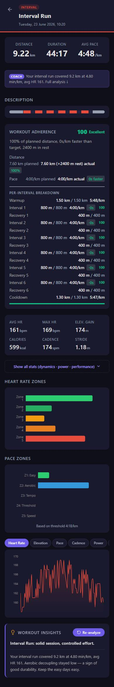

| ID | Sev | Finding | Evidence |
|---|---|---|---|
| **D1** | S3 | **"Description" heads a bare structure bar** with no labels, legend or values. On desktop it's the first thing top-left, above the stats (D6). | `ActivityDetailView.tsx` |
| **D2** | S3 | **The coach says the same thing twice**: a "COACH" chip under the stats ("Full analysis ↓"), then a "Workout insights" card at the very bottom with the same sentence. | `ActivityDetailView.tsx`, `AiInsightCard.tsx` |
| **D3** | S2 | **HR zones show bars with no values.** Minutes appear only in a hover tooltip (`HrZonesChart.tsx:54-58`), which on a phone effectively means never. Zone labels wrap ("Zone / 1"). Pace zones: same. | `HrZonesChart.tsx:44-52` |
| **D4** | S2 | **The HR chart has no x-axis and a zoomed y-axis (160–170)**, so a 9 bpm range looks like a cliff face and there's no way to place a spike in the run. For intervals, rep windows should be shaded. | `ChartTabs.tsx` |
| **D5** | S3 | **The adherence card is a 13-row table** (warm-up, 6 intervals, 6 recoveries, cool-down) of "800 m / 800 m 4:00/km -0s 100". The answer to "did I hit my reps?" is a six-bar chart; the table can sit behind "All laps". | `AdherenceCard.tsx` |
| **D6** | S3 | **Desktop order puts structure and zones above the headline stats** (left column first). | desktop capture |
| **D7** | S3 | **The effort rating (RPE) is asked deep in the detail page.** The moment to ask is right after the run, which is when the athlete opens Today. Decided in §8. | `FeedbackPrompt.tsx` |

### 4.6 Progress

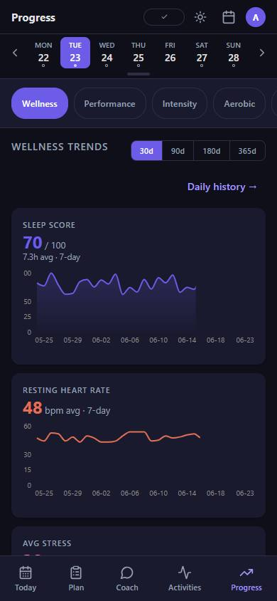

| ID | Sev | Finding | Evidence |
|---|---|---|---|
| **G1** | **S1** | **Y-axis labels are clipped: "100" renders as "00"** on Sleep score and Body battery. `yAxisProps.width = 28` with 10px tick labels. | `WellnessTrendsView.tsx:116-121` |
| **G2** | S2 | **Five charts, five hues, no baseline.** Sleep purple, RHR orange, stress pink, body battery green, HRV blue. None shows the athlete's normal range, so "is 42 ms HRV a problem?" can't be answered from the screen. | `WellnessTrendsView.tsx` |
| **G3** | S3 | **Six tabs that scroll off-screen** (Wellness, Performance, Intensity, Aerobic, Records, Custom), then a "WELLNESS TRENDS" heading repeating the selected tab, then a range control, then a "Daily history →" link on its own row: four layers of chrome before the first chart. | `TrendsView.tsx:12-19` |

### 4.7 Coach

| ID | Sev | Finding | Evidence |
|---|---|---|---|
| **C1** | S3 | **The empty state is generic**: a brain icon, "Ask your AI coach anything", four static prompts. The coach knows today's readiness (55), today's session (intervals) and the next race (10K in 18 days); the starter prompts should use that ("Readiness is 55, should I still do the intervals?"). The global week strip (X1) sits above the conversation doing nothing. | `ChatView.tsx` |

### 4.8 Settings

| ID | Sev | Finding | Evidence |
|---|---|---|---|
| **S1** | S2 | **One 4,600px scroll of fourteen sections**: account, Garmin form, a 12-field profile form, coach memory, notifications, system health, threshold estimation, three zone tables, AI backend, export, database counts, manual sync. Nothing says what's where, and most visits need one row. | `SettingsView.tsx` |
| **S2** | S3 | **Zone names are truncated to three letters** ("Rec", "Aer", "Ten") in narrow inputs. | `ZoneConfigSection.css:84-102` |
| **S3** | S3 | **No Appearance section.** Theme lives in the top bar (X3). | — |

### 4.9 Accessibility

| ID | Sev | Finding | Evidence |
|---|---|---|---|
| **Y1** | **S1** | **The readiness score fails contrast in light mode.** `#fdcb6e` text on the ring's `rgba(0,0,0,.15)` fill over white is about **1.1 : 1** (needs 4.5 : 1, or 3 : 1 for large text). The number the hero exists to show is barely readable. | `ScoreRing.css:9`, `ReadinessCard.tsx:12` |
| **Y2** | S2 | **Colour-only encodings**: workout type in week strip dots, plan border colours, chart series that differ only by hue. | various |
| **Y3** | S2 | **Values available only on hover** (zone minutes, chart points). | D3, D4 |
| **Y4** | S3 | `prefers-color-scheme` not honoured (X3). | `index.html:15-20` |

---

## 5. Design direction

**Approved by the owner (§8, Q1).** The stock Flat UI palette on navy is replaced
with a direction drawn from the subject: one athlete, a Garmin watch, a coach's
notation, and a daily question ("what am I running, and am I up for it?").

### 5.1 Principles

1. **Colour means effort.** The only colour in the interface is the intensity
   scale, in **Garmin's zone order** (grey, blue, green, orange, red), so what
   the watch shows and what the app shows agree. Workout types map onto it
   (recovery Z1, easy and long Z2, tempo Z4, intervals and race Z5). Status,
   selection and brand use ink, not hue.
2. **The session comes first.** The workout, written the way a coach writes it
   ("6 × 800 m at 4:00"), with its structure drawn in effort colour, is the
   biggest thing on the most important screen. The same strip repeats in Plan,
   Activities and the run analysis, so one visual idea runs through the app.
3. **Every number has a reference**: a target, a baseline, or the plan. A number
   with nothing to compare against goes behind a tap or is removed.
4. **Chrome only where it acts.** A control that does nothing on a screen
   doesn't render there.

### 5.2 Tokens

| Token | Light | Dark | Role |
|---|---|---|---|
| `--ground` | `#ECEEF0` | `#111416` | Page behind panels |
| `--surface` | `#FFFFFF` | `#1A1E21` | Panels |
| `--surface-2` | `#F2F4F5` | `#22272B` | Pressed state, today row, quiet button |
| `--ink` | `#121518` | `#E8EBED` | Text, primary buttons, selection, focus |
| `--ink-2` | `#525B64` | `#A3ACB4` | Secondary text (6.9 : 1 / 7.3 : 1 on surface) |
| `--rule` | `#D8DDE1` | `#2C3338` | Hairlines, tracks |
| `--z1`…`--z5` | `#8A96A3 #2D7BCB #2B9156 #DD7A1E #D0353A` | `#8F9BA8 #4B96E2 #3DAE6B #EF8F37 #EC5459` | Effort only |

Notes:

- **Primary actions are ink, not a hue.** A black button on light (white on
  dark) never competes with effort colour and needs no extra brand colour.
- **Alerts use inversion, not red.** A re-auth or missed-sessions banner is an
  ink bar with on-ink text, which gets attention without borrowing Z5's meaning.
- **Effort colours are for marks, not text.** Against `--surface` every `--z*`
  clears 3 : 1 for non-text graphics (light: Z1 3.0, Z2 4.4, Z3 4.0, Z4 3.1,
  Z5 4.9; dark: 4.8–6.9). Labels next to a mark stay in ink, so colour is never
  the only carrier (Y2).
- **Shadows go.** Panels separate from the ground by tone.

### 5.3 Type

- **One family: Archivo** (variable, SIL OFL; weight 100–900, width 62–125).
  Width does the work a second typeface would: numerals at `font-stretch: 75%`,
  weight 700, tabular lining figures, like the condensed numbers on a race bib
  or a stadium clock; prose at 100%. Self-host a Latin subset `woff2` under
  `/static/fonts/` (roughly 100 KB) so the PWA keeps working offline. It's a
  font file, not an npm dependency.
- **Scale (mobile):** 12 · 13.5 · 15 (body) · 16 (panel heading) · 22 (screen
  title) · 26–28 (figures) · 44 (session notation).
- **Sentence case everywhere.** No uppercase tracked labels; hierarchy comes from
  size, weight and width.
- **Numbers and units:** value in condensed bold, unit in regular 100% width at
  about half size (`9.22 km`, `4:48 /km`). Pace is always `m:ss /km`.

### 5.4 Layout rules

- One column on mobile, 12px gutters, 16px panel padding, 12px between panels.
- **No nested cards.** A panel holds rows separated by hairlines.
- Two radii with meaning: 16px for panels, 10–12px for controls; chips are pills.
- Left-aligned text; numbers right-aligned in lists so they line up.
- Metadata goes in aligned columns, not middle-dot strings.

### 5.5 Rejected alternatives

- *Dark navy with a neon accent*, the stock sports-app look: it's roughly what
  the app already is, and it makes every data colour fight the brand colour.
- *A single new brand hue* (say, a track-surface red): it would collide with Z5
  and recreate X5.
- *The Nothing OS skin* (black/white, dot-matrix numerals, mono micro-labels):
  built on a branch and rejected by the owner as unreadable (§8).

---

## 6. Proposed screens

Proposals are rendered in light mode; the mockup file has a dark toggle. Two
dark renders are included to show the token mapping holds.

### 6.1 Today, before the run

<table><tr>
<td valign="top"><b>Current</b> 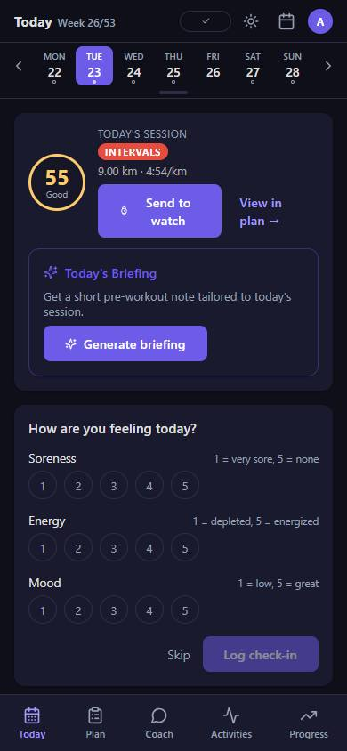</td>
<td valign="top"><b>Proposed</b> 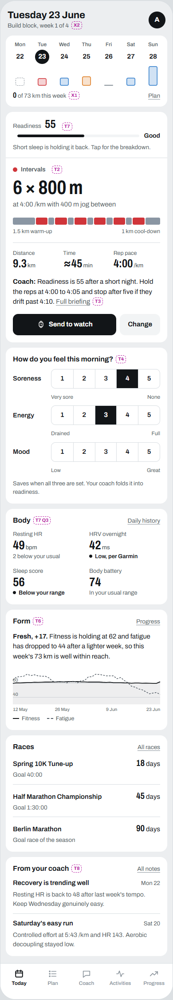</td>
<td valign="top"><b>Proposed, dark</b> 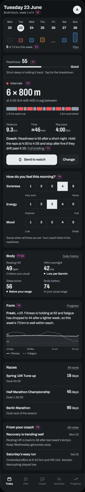</td>
</tr></table>

What changes (IDs refer to §4):

- **Top bar** (X2, X3, X4): the date as the title, the training block as the
  subtitle, and the avatar. No theme toggle, sync pill or ISO week.
- **Week rail** (X1, T5): replaces the global week strip, on Today only. Each
  day shows its planned session as a bar (height = distance, colour = effort):
  filled when done, outlined when planned, dashed when missed. "0 of 73 km this
  week" sits underneath. It also replaces the mislabelled "Week 26 Overview"
  panel; the eight-week volume chart moves to Progress, where its total can be
  labelled as such.
- **Readiness line** (T7, Y1): score, a neutral meter, the word, and the
  limiting factor in plain language ("Short sleep is holding it back"). Tapping
  opens the existing component breakdown. No traffic-light ring.
- **Session** (T2, T3): workout kind, notation in 44px condensed figures, a
  sub-line with recoveries, a structure strip with warm-up/cool-down labels,
  three figures (distance, time, **rep** pace), a one-sentence briefing inline,
  one primary action. "Change" opens the swap/move sheet (v6 B-1); before B-1
  ships it can open Plan.
- **Check-in** (T4): one row per question, joined 5-segment control (44px
  targets), end labels under the scale, auto-save once all three are set. Once
  logged it collapses to a single summary line.
- **Body** (T7, Q3): four metrics, each with a comparison. HRV uses **Garmin's
  status** ("Low, per Garmin"); the others use your own 90-day range ("2 below
  your usual", "Below your range"). Steps drop off Today.
- **Form** (T6): one sentence plus a two-line chart (fitness solid, fatigue
  dashed). ACWR and TSB stay on Progress → Fitness and the training-load info
  page.
- **Races** (T9): includes the season goal race.
- **From your coach** (T8): the latest two notes, each with a title, a date and
  one line; "All notes" opens the list.

### 6.2 Today, after the run

<table><tr>
<td valign="top"><b>Current</b> (hero unchanged; run at the bottom) </td>
<td valign="top"><b>Proposed</b> 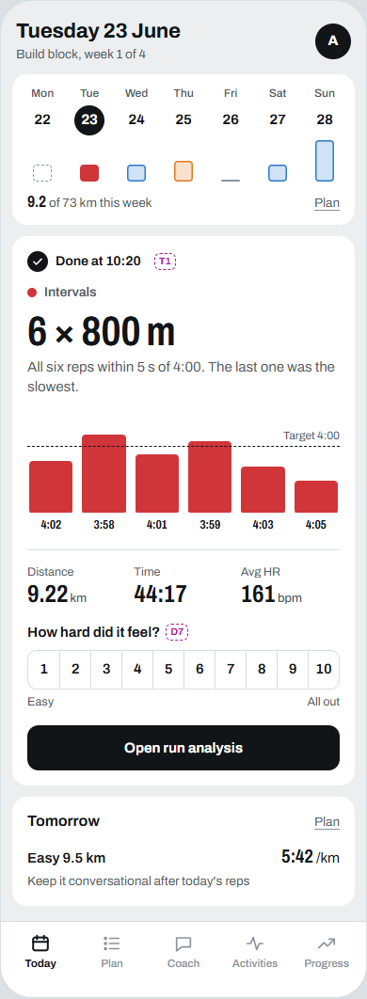</td>
</tr></table>

- **T1**: the hero becomes the result: "Done at 10:20", the notation, one
  sentence of verdict, the six reps against a target line, three figures.
- **D7**: "How hard did it feel?" (1–10) is asked here (decided, §8 Q2); the
  button then opens the full analysis.
- The rail fills Tuesday in and the week total updates. A "Tomorrow" panel
  previews the next session.
- **Ambiguous match**: when a run of the same category exists on a plan day but
  the match is uncertain (two runs, or the type differs), the hero asks once:
  "Was your 10:20 run today's intervals? Yes / No". The answer is stored on the
  plan day.

### 6.3 Plan

<table><tr>
<td valign="top"><b>Current</b> </td>
<td valign="top"><b>Proposed</b> 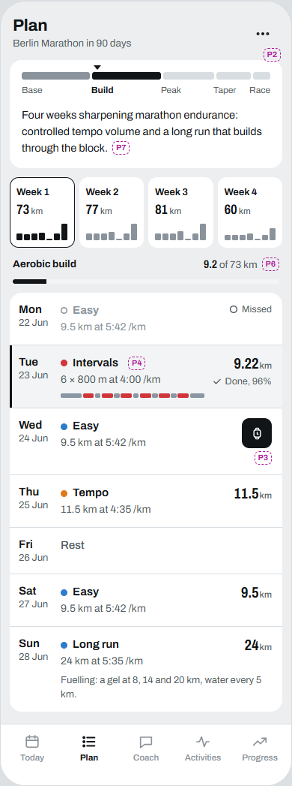</td>
<td valign="top"><b>Proposed, dark</b> 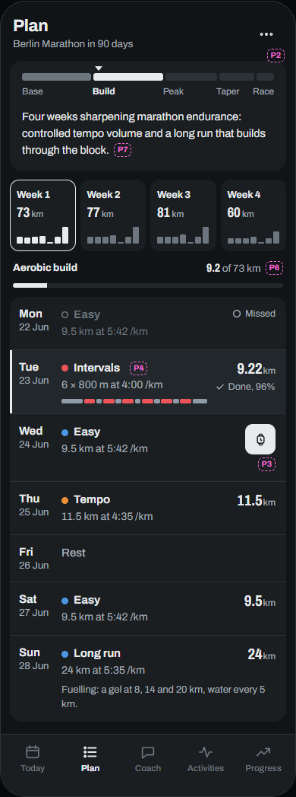</td>
</tr></table>

- **P1**: no global strip. The week selector is the only week control: four
  tiles with km and a seven-bar shape.
- **P2**: Preferences and Regenerate go into the "⋯" menu; Regenerate keeps its
  confirm step.
- **P7**: monochrome season ribbon with a "you are here" caret; the block summary
  sits under it.
- **P4**: one effort dot per row. Today gets a tonal row and an ink rule, not a
  purple outline.
- **P3**: "Send to watch" appears only on the next unsent session (40px icon
  button with an aria-label naming the day). Notes render only when they differ
  from the block default.
- **P6**: today's completed run shows "9.22 km, Done, 96%" and counts toward the
  week.
- Interval rows show the notation and a thin structure strip (needs v6 B-3 for
  AI days; Garmin-scheduled days have steps already).

### 6.4 Activities

<table><tr>
<td valign="top"><b>Current</b> 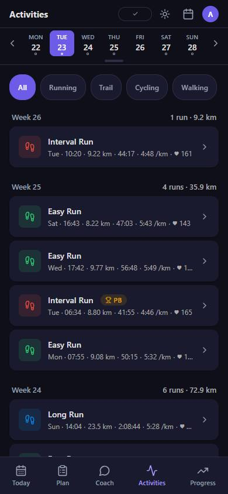</td>
<td valign="top"><b>Proposed</b> 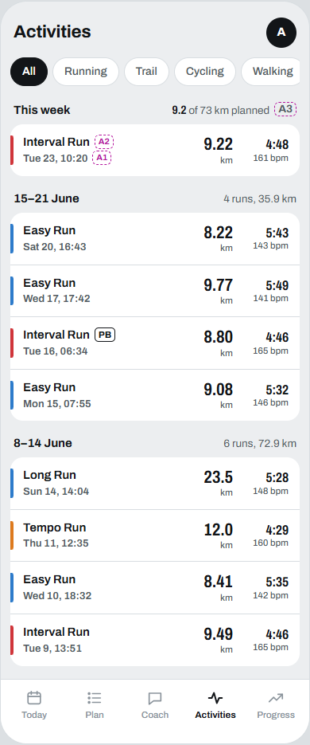</td>
</tr></table>

- **A1, X7**: four-column row (effort tick · name and when · distance · pace over
  HR). Nothing truncates at 360px.
- **A2**: distance is the largest figure in the row; the shoe tile becomes a 4px
  effort tick.
- **A3**: "This week" compares against the plan; past weeks are labelled with
  date ranges ("15–21 June").

### 6.5 Run analysis

<table><tr>
<td valign="top"><b>Current</b> </td>
<td valign="top"><b>Proposed</b> 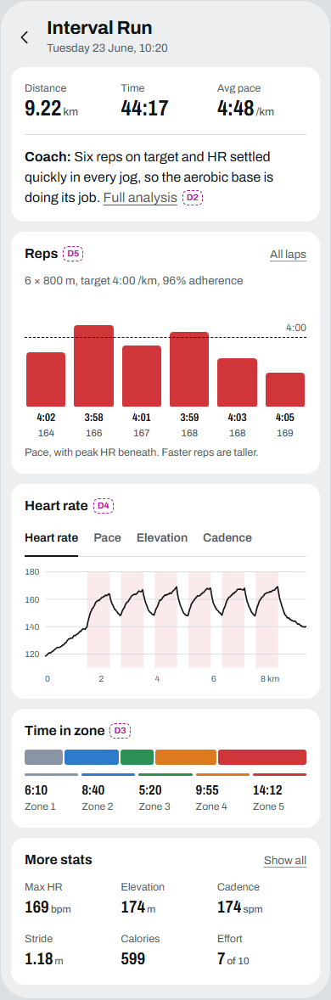</td>
</tr></table>

- **D2**: stats, then one coach verdict; "Full analysis" expands the AI insight
  in place. The duplicate bottom card is gone.
- **D1, D5**: "Reps" chart for structured sessions: one bar per rep (taller =
  faster), dashed target line, pace and peak HR under each. "All laps" opens the
  current table. Unstructured runs keep SplitsBars here instead.
- **D4**: HR over **distance**, x-axis in km, y-axis from 120, rep windows shaded
  in Z5 at 10%. The pill tabs become a plain text tab row.
- **D3**: a single 100% stacked zone bar with minutes printed under each zone.
- **D6** (desktop): stats and verdict lead the left column; charts follow.

### 6.6 Progress

<table><tr>
<td valign="top"><b>Current</b> </td>
<td valign="top"><b>Proposed</b> 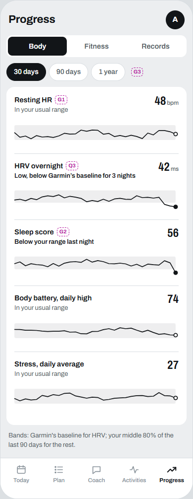</td>
</tr></table>

- **G3**: three tabs, **Body / Fitness / Records**. Fitness absorbs Performance,
  Intensity and Aerobic as sections and ends with "Build a chart" (Custom).
- **G2, Q3**: small multiples in ink over a shaded **usual range**. HRV's band
  and verdict come from Garmin's baseline and status ("Low, below Garmin's
  baseline for 3 nights"). Resting HR, sleep, body battery and stress use the
  middle 80% of the last 90 days. Each row states the verdict in words and fills
  the last point when it is out of range.
- **G1**: no y-axis on small multiples. Where axes remain (Fitness tab), use
  `width: 'auto'` or a 36px minimum so "100" fits.

### 6.7 Settings

<table><tr>
<td valign="top"><b>Current</b> (top of a 4,600px page) 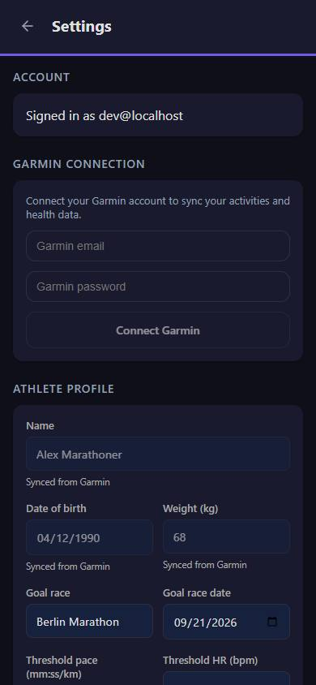</td>
<td valign="top"><b>Proposed</b> 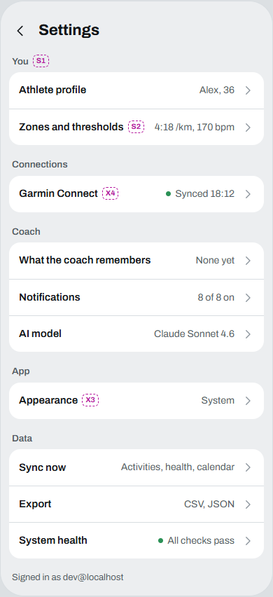</td>
</tr></table>

- **S1**: an index of five groups (You, Connections, Coach, App, Data). Each row
  shows its current value and pushes a sub-route (`/settings/profile`,
  `/settings/zones`, `/settings/garmin`, …). The existing section components
  move into those pages unchanged.
- **X3, S3**: Appearance (System / Light / Dark), default System.
- **X4**: the Garmin row shows "Synced 18:12" or "Reconnect needed".
- **S2**: the zones page gets full width for names.

### 6.8 Screens not mocked

- **Coach (C1)**: drop the week strip; starter prompts built from today's state
  (readiness, session, next race, last run), for example *"Readiness is 55,
  should I still do the intervals?"*, *"How did Tuesday's reps compare to last
  week?"*, *"Am I on track for 40:00 at the 10K?"*.
- **Desktop**: keep the left rail. Today's two columns become session + check-in
  on the left, Body + Form + races on the right; the rail stays full-width on
  top.

---

## 7. Implementation plan

Global rules (carry over from `UI_UX_REDESIGN_PLAN.md` §6.0): tokens only, no new
npm dependencies, `cd frontend && npm run build && npm test` green, backend
changes additive with tests, and a **real-browser screenshot at 390 × 844 and
1280 × 800, light and dark**, for every visual change (jsdom can't catch layout
bugs; see `tasks/lessons.md`). The review setup in §1 (perf.db copy + pinned
clocks) is the recommended harness.

**Order rationale:** the visual identity (Phase 3) lands *before* the screen
rewrites (Phases 4–6), so new components are built on the new tokens once instead
of being restyled afterwards.

### Phase 1: Correctness (S1 items; small, ship first)

| Task | Files | Acceptance |
|---|---|---|
| **1.1 Same-day plan matching (T1, P6).** In `/today`, after calendar-event matching, match remaining activities against the selected date's `TrainingPlanDay` by `_categorize_activity_type` plus a distance/duration tolerance. Set `workout_tag` from the plan day and add `matched_plan_day_id`. In `_match_activity_and_adherence`, allow `day_date == today` *when a matching activity exists* (still skip future days). | `app/routers/daily.py:186-205`, `app/routers/plan.py:65-90`, `app/schemas.py` | Seeded 23 June: hero shows the done state; Plan's Tue row shows done + adherence; week progress 9.2 / 73. New tests: same-day match, two runs one plan day, type mismatch (no match). |
| **1.2 Week total label (T5).** Until Phase 4 removes the panel: title "Last 8 weeks" and headline "504.2 km in 8 weeks". | `TodayView.tsx:190-194`, `WeekOverview.tsx:78-80` | Title and number describe the same period. |
| **1.3 Clipped y-axis (G1).** `width: 36` (or measured) on every `YAxis` with a 0–100 domain. | `WellnessTrendsView.tsx:116-121`, grep `width: 28` | "100" fully visible at 390px. |
| **1.4 Readiness contrast (Y1).** Number in `var(--text)`; colour moves to the ring stroke only; remove the ring's dark fill in light mode. | `ScoreRing.css:9`, `ScoreRing.tsx` | ≥ 4.5 : 1 in both themes. |

### Phase 2: Chrome and IA (X1–X4, P1, C1, G3)

- **2.1** Add `weekStrip?: boolean` to `RouteMeta`; only `/` sets it.
  `CalendarContainer` renders only when set. Plan, Coach, Activities and Progress
  gain about 80px. (`App.tsx:54-80,121-130`)
- **2.2** Subtitle from training context: new `useTrainingContext()` deriving
  `{phase, weekOfBlock, blockWeeks, goalRace, daysToGoal}` from
  `useTrainingPlan()` + season plan + races. TopBar renders the date as the title
  on Today and the context as the subtitle; drop `weekLabel`.
- **2.3** Theme: `'system' | 'light' | 'dark'`, default `system`, resolved via
  `matchMedia` with a change listener; update the pre-paint script in
  `index.html` to honour the system setting. Move the control to a new
  Settings → Appearance section; remove the top-bar toggle.
- **2.4** Sync pill: render only on `needs_reauth` or a stale sync (> 6 h);
  otherwise nothing. Garmin row in Settings (Phase 7).
- **2.5** Progress tabs: Body / Fitness / Records. Fitness stacks the existing
  Performance, Intensity and Aerobic views as sections with one shared
  `RangeSelector`; Custom becomes a "Build a chart" entry at its end. Drop the
  duplicate in-tab heading.
- Tests: route-meta test that only `/` has the strip; theme resolution test;
  TrendsView tab test updated.

### Phase 3: Visual identity (tokens and type)

- **3.1** Add `--z1…--z5` and the neutral tokens (§5.2) to `globals.css` for
  both themes. Map `--color-easy` → `--z2`, `--color-tempo` → `--z4`,
  `--color-interval`/`race` → `--z5`, `--color-long` → `--z2`,
  `--color-cross`/`strength` → `--z1`. Point `chartTheme.ts` and the API zone
  colours at the same tokens; replace `scoreColor`'s hex bands
  (`ReadinessCard.tsx:10-15`) with ink.
- **3.2** Replace `--accent` usages: primary button, selected chip and active nav
  become ink; links become underlined ink-2. Grep `var(--accent` (about 130 uses)
  and decide each one. Replace hard-coded `color: #fff` on token fills with an
  `--on-ink` token.
- **3.3** Self-host Archivo (Latin subset, `woff2`, `font-display: swap`); add
  `--font-ui` and a `.num` utility (75% width, 700, tabular) and apply it to stat
  values, figures and chart ticks.
- **3.4** Remove uppercase/tracking from `.section-title`, `.stat-label` and
  `.badge`; sentence-case all headings; drop "→" from link text (X8).
- **3.5** Remove `box-shadow` from `.card`; panels separate by tone. Alert banner
  becomes an inverted ink bar.
- **3.6** `index.html` `theme-color` follows the new ground colours.
- Acceptance: screenshots of all five tabs in both themes; contrast check of
  `--ink-2` and every `--z*` against `--surface` (≥ 3 : 1 for marks, ≥ 4.5 : 1
  where used as text).

### Phase 4: Today

- **4.1 `SessionHero`** (replaces `HeroSession` internals): kind + notation +
  sub-line + `WorkoutStructureBar` (large variant) + three figures (distance,
  est. time, *key* pace) + inline briefing sentence + one primary action.
  Notation source order: `workout_steps` (Garmin or v6 B-3), then the parsed
  plan-day `description`, then type + distance. Key pace = fastest work-step
  target, not the session average.
- **4.2 Done state** using 1.1's match: `RepChart` (new, in `ui/`, shared with
  detail), figures, inline RPE (§8 Q2), and an ambiguous-match confirm row.
- **4.3 `ReadinessLine`**: score, neutral meter, label, limiting factor (lowest
  component → copy map), reusing the accordion.
- **4.4 Check-in**: segmented rows, auto-save on the third answer, collapsed
  summary after save. Keep Skip.
- **4.5 `WeekRail`**: replaces `WeekStrip` on Today and `WeekOverview`. Data:
  `useTrainingPlan()` days for the selected week + `useCalendarWeek()` done
  markers. Accessible name per day ("Thursday 25, tempo 11.5 km, planned").
- **4.6 Baselines (Q3)**, shared by Today's Body panel and Progress → Body:
  - *Backend, HRV:* in the daily-summary sync, also read Garmin's HRV baseline
    from `hrvSummary` (today only `lastNightAvg`, `weeklyAvg` and `status` are
    read, `app/garmin_sync.py:773-776`). Store it as additive
    `DailySummary.hrv_baseline_low` / `hrv_baseline_high` (Alembic migration),
    expose on `DailySummaryResponse`. **First capture a live payload** to
    confirm the field names (expected `baseline.balancedLow` /
    `baseline.balancedUpper`); if absent, fall back to `hrv_status` +
    `hrv_weekly_avg` and draw no band. Tests with a recorded payload fixture,
    with and without `baseline`.
  - *Frontend, HRV:* verdict text from `hrv_status` (Balanced / Unbalanced /
    Low / Poor → "Balanced, per Garmin", …), band from the stored baseline.
  - *Frontend, other metrics:* `usePersonalRange(metric)` computes the
    10th–90th percentile of the last 90 days from existing daily summaries
    (client-side; move server-side only if it gets slow). Verdicts: "In your
    usual range", "Below/Above your range" (+ "for N nights" when ≥ 2).
- **4.7 Form panel**: sentence generator from CTL/ATL/TSB bands (existing copy in
  `statInfo.ts`) and a two-series chart. ACWR leaves Today.
- **4.8 Coach notes**: latest two insights with date + linked activity; "All
  notes" opens a list.

### Phase 5: Plan

- 5.1 Strip already removed (2.1); week tiles with a seven-bar shape (data
  already in `weeks[].days`).
- 5.2 Overflow menu for Preferences/Regenerate (reuse `BottomSheet`).
- 5.3 Day row restyle: single effort dot, tonal today row, notation line, thin
  strip when steps exist, done/missed status text with glyph.
- 5.4 Send-to-watch on the next unsent session only; notes only when they differ
  from the block default.
- 5.5 Monochrome `SeasonTimeline` with caret.

### Phase 6: Activities, run analysis and Progress

- 6.1 `ActivityListItem` four-column grid; drop the meta string; effort tick
  colour from the effort map.
- 6.2 Group header: "This week" with planned km; past weeks as date ranges.
- 6.3 Detail: verdict-only top block, duplicate insight card removed (expand in
  place), `RepChart` for structured workouts (from `adherence.steps`), HR chart
  with distance axis + rep shading + y floor, stacked zone bar with printed
  minutes, desktop order fix. Keep `FeedbackPrompt` as the place to edit the
  rating, sharing state with Today's prompt.
- 6.4 Progress → Body small multiples on `usePersonalRange` + the HRV baseline
  (4.6).

### Phase 7: Settings

- 7.1 `/settings` becomes an index with sub-routes per group; the existing
  sections move in; back header on each sub-page.
- 7.2 Appearance row (2.3), Garmin status row, full-width zones page.

### Effort and order

| Phase | Size | Depends on |
|---|---|---|
| 1 Correctness | S (½–1 day, incl. backend tests) | — |
| 2 Chrome & IA | S–M (1 day) | — |
| 3 Visual identity | M (1½ days) | — |
| 4 Today | M–L (2½–3 days, incl. HRV baseline sync) | 1.1, 3; v6 B-3 for full notation |
| 5 Plan | M (1 day) | 2.1, 3 |
| 6 Activities, detail, Progress | M (1½ days) | 3, 4.2, 4.6 |
| 7 Settings | S–M (1 day) | 2.3 |

Phases 1 and 2 alone remove every S1 item and most of the daily friction.

---

## 8. Owner decisions

### Q1. Visual direction: §5, Nothing OS skin discarded

The owner rejected the Nothing OS skin ("I don't like it and it's unreadable")
and approved the direction in §5. Consequences:

- The skin branch `origin/claude/activity-nothing-theme-ui-4qgdfo` stays
  **unmerged**. Deleting it is the owner's call; nothing on `main` depends on it.
- `docs/NOTHING_OS_SKIN_PLAN.md` is marked abandoned. Its mockup stays in
  `docs/mockups/` for history.
- Nothing from the branch needs salvaging: the System/Light/Dark control (2.3) is
  small enough to write fresh against the new tokens.

### Q2. Effort rating (RPE) after a run: ask on Today

**Decision: ask on Today's done-state hero; keep the run page as the place to
edit it.** Both write the same field through the same mutation, so there is one
source of truth.

Why:

1. **Timing is accuracy.** The app already uses the rating as the session's
   intensity when it computes training load (`app/training_load.py:134-136`,
   source `srpe`). The session-RPE method behind that asks for the rating about
   30 minutes after the session, while the effort is still fresh. The next time
   the athlete opens the app after a run is almost always Today, after the watch
   syncs. The run page is opened later, if at all, and recall drifts toward how
   the run *looked* (pace, HR) rather than how it *felt*.
2. **Completion drives the numbers.** The rating feeds training load and
   readiness. An unrated run falls back to a pace/HR estimate, and the
   subjective signal (a bad day, heat, illness) is lost. A prompt on the screen
   the athlete is already looking at, with one tap and no navigation, gets
   answered; three scrolls down a run page, it mostly doesn't.
3. **Little cost.** Ten segments inside a hero that is already in its "done"
   state. It collapses to "Felt 7/10" once answered and disappears the next day.

Rules: show it only for today's matched run that isn't rated yet. For an
unmatched run, show it on that run's row under "Also today". Never ask again once
rated.

### Q3. Where the "usual range" comes from: Garmin for HRV

**Decision: HRV uses Garmin's own baseline and status; resting HR, sleep score,
body battery and stress use the app's 10th–90th percentile of the last 90
days.** The app never contradicts the watch on HRV, and the other four metrics,
for which Garmin provides no personal range, still get one. Implementation in
§7 task 4.6.

---

## 9. Risks and non-goals

**Risks**

- **Same-day matching false positives (1.1).** An easy shake-out on an interval
  day would "complete" the intervals. Match on category *and* a distance/duration
  tolerance, and fall back to the confirm row when unsure.
- **Garmin HRV baseline fields are unverified** against a live payload (4.6).
  Fallback: status + weekly average, no band.
- **Colour loss.** Easy and long share Z2, so the colour that told them apart
  goes. Long runs remain distinguishable by name, distance and bar height.
  Accept that, or give long runs a hatched fill if real use says otherwise.
- **Ink primary buttons** read as less "branded". That's intended; the app's
  identity comes from type and the effort strip, not a button colour.
- **Font weight on the PWA** (about +100 KB). Subset it and cache via the
  service worker.

**Non-goals**

- No new tabs and no features beyond what the v6 plan already lists.
- No alternative skins; one design, light and dark.
- No imperial units, multi-source import or manual activity entry (v6 owner
  scope).

---

## 10. Appendix: finding index

| ID | Sev | Area | One line |
|---|---|---|---|
| T1 | S1 | Today | Same-day run on an AI-plan day isn't recognised |
| P6 | S1 | Plan | Week progress ignores today's run |
| T5 | S1 | Today | "Week 26 Overview" headline is an 8-week total |
| G1 | S1 | Progress | Y-axis clips "100" to "00" |
| Y1 | S1 | A11y | Readiness number about 1.1 : 1 contrast in light mode |
| X1 | S2 | Chrome | Week strip on five tabs, used by one |
| X2 | S2 | Chrome | ISO week instead of training block |
| X5 | S2 | Identity | Colour has no single meaning |
| T2 | S2 | Today | Hero doesn't describe the workout |
| T3 | S2 | Today | Two primary buttons, nested card |
| T4 | S2 | Today | Check-in costs a full fold |
| T6 | S2 | Today | Training load overload |
| T7 | S2 | Today | Numbers without baseline |
| P1 | S2 | Plan | Three week navigators |
| A1 | S2 | Activities | Meta line truncation |
| D3 | S2 | Detail | Zone values only on hover |
| D4 | S2 | Detail | HR chart: no x-axis, zoomed y |
| G2 | S2 | Progress | Rainbow charts, no baseline |
| S1 | S2 | Settings | 14-section single scroll |
| Y2 | S2 | A11y | Colour-only encodings |
| Y3 | S2 | A11y | Hover-only values |
| X3 | S3 | Chrome | Theme toggle in top bar; OS preference ignored |
| X4 | S3 | Chrome | Empty sync pill |
| X6 | S3 | Identity | System font, uppercase labels everywhere |
| X7 | S3 | Copy | Middle-dot strings truncate |
| X8 | S3 | Copy | "→" on links, Title Case, "My" |
| T8 | S3 | Today | Insights lack date/context |
| T9 | S3 | Today | Goal race missing from Today |
| P2 | S3 | Plan | Admin actions lead the page |
| P3 | S3 | Plan | Repeated notes and send buttons |
| P4 | S3 | Plan | Workout type encoded three times |
| P5 | S3 | Plan | Week tabs show only km |
| P7 | S3 | Plan | Rainbow season ribbon |
| A2 | S3 | Activities | Distance not the primary figure |
| A3 | S3 | Activities | Week header lacks plan reference |
| D1 | S3 | Detail | "Description" heads an unlabelled bar |
| D2 | S3 | Detail | Coach text duplicated |
| D5 | S3 | Detail | 13-row adherence table first |
| D6 | S3 | Detail | Desktop order buries stats |
| D7 | S3 | Detail | RPE asked too late (decided: Today) |
| C1 | S3 | Coach | Generic, context-free starter prompts |
| S2 | S3 | Settings | Zone names truncated |
| S3 | S3 | Settings | No Appearance section |
| Y4 | S3 | A11y | `prefers-color-scheme` not honoured |
